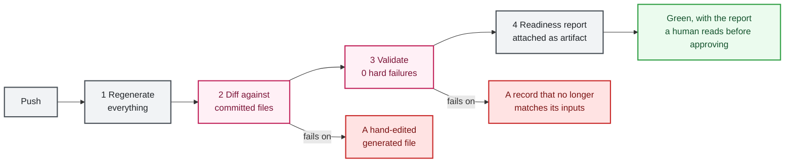

# Continuous integration

Two interchangeable implementations ship here, enforcing the same gates. Pick whichever fits your environment. The security comes from the gates, not from the vendor.

## The four gates

Whichever you run, this is what must happen on every change:

1. **Regenerate everything** from the pinned dataset and the record store.
2. **Fail on any hand-edited output.** Regenerate, then diff. If a generated file differs from what the pipeline produces, the build fails. This turns "do not edit generated files" from a convention into an error.
3. **Validate with zero hard failures.** `python sdr.py validate` runs the full validation gate (SDR schema/coverage/fidelity, package schemas, CPO semantics, assurance-graph traceability, the human review register, evidence integrity, and cross-artifact consistency) plus the offline test suite. GitHub Actions additionally enforces a double-build reproducibility gate and the scanner-catalog freshness check.
4. **Attach a readiness report** so a human approver can read it before signing.

Submission readiness (`preflight`) is deliberately not one of these build-time gates: it is a stricter, separate check run at submission time. See [validation and readiness](validation.md#submission-readiness-preflight).



Gate 2 is the one people leave out, and it is the one that keeps the whole traceability claim honest. Without it, someone edits the JSON directly under deadline pressure and the record silently stops matching its inputs.

## GitHub Actions

No AWS account needed. Free-tier friendly.

| Workflow | Trigger | What it does |
|---|---|---|
| `.github/workflows/validate.yml` | push, pull request | Runs the four gates, the two anti-circular audit gates and the two assessor-attack gates (below), the hard security gate, refuses a stale scanner check catalog, attaches the readiness report as a build artifact. A `release-gate` job aggregates the gate jobs into the one status check `main` requires |
| `.github/workflows/drift-check.yml` | daily schedule | Hash-compares pinned FedRAMP sources against upstream and, on drift, opens a ready-to-review adoption PR (see "Hands-off adoption" below) |
| `.github/workflows/release.yml` | push of a `v*` tag | Refuses a tag that is unsigned, not on protected `main`, not signed by a listed key, or not the manifest's `release_tag`; re-runs the validate workflow; publishes the attested bundle (see [versioning](versioning.md#publishing-a-release)) |
| `.github/workflows/living-sdr-loop.yml` | daily schedule, manual dispatch | The provider-deployable living loop: read-only collection, metric append, regeneration, a PR when a committed deliverable changes (see [automation](automation.md#persistence-and-retention)). Its `collect` job is skipped until the `AWS_OIDC_ROLE_ARN` repository variable is set, so on a fresh fork it records nothing |

Dependabot (`.github/dependabot.yml`) opens one grouped pull request a month for pip and one for GitHub Actions. A pip bump changes an INPUT file, and the hash-locked CI install only sees `requirements.lock`; `.github/workflows/dependabot-lock.yml` completes the bump on the Dependabot branch (both locks re-resolved with the Makefile flags, SBOM and release manifest rebuilt, one commit pushed), so the PR arrives at CI complete and merges on green. Nothing is run by hand. Security advisories are not delayed by the monthly schedule: pip-audit in the release gate fails on a known vulnerability on every run.

### Anti-circular-verification audit gate

The `audit-gate` job in `validate.yml` runs two independent checks that a green test suite alone cannot provide, both hard gates:

- **Mutation runner** (`audit/mutation_tests.py`) re-introduces each closed defect into the production code and asserts its named regression test goes red. A surviving mutation means a test cannot detect the defect it claims to guard, and the build fails. When you fix a new defect, add a mutation entry and a ledger record (`audit/defect-ledger.json`); the runner skips a mutation whose target code is not present, so a fix on an unmerged branch never passes falsely.
- **Requirements-differential oracle** (`audit/requirements_oracle.py`) derives the KSI universe and the Class-B-optional set from the raw pinned dataset with a traversal independent of the production applicability engine, then reconciles the two. Any discrepancy fails the build.

The AWS CodeBuild release path (`RELEASE_MODE=true`) runs the same two checks, so the internal pipeline is not weaker than the public gate.

### Assessor-attack gate

The `attack-gate` job runs the `attack` section of the same release gate definition: the Class C assessor-attack harness (`examples/sample-offering-class-c/build_class_c_sample.py --attack`). It builds a fully populated fictional Class C package, drives it to Submission ready, then applies one hollowing tamper at a time (empty metric summaries, placeholder evidence, a single automated method, a stale assessment, hashless or unsigned evidence under a required signer, content-free CPO answers, and more) and fails the build if any tamper still reaches ready, or if the justified baseline does not. A tree-clean step follows because the harness restores every file it overwrites. It runs as its own job, in parallel with `validate` (about 20 minutes), and the `release-gate` aggregate requires it (AUD-F61). Before that it was a manual run, and two of its probes had stopped testing anything for 18 merged pull requests without anyone noticing.

The `attack-gate-non-aws` job runs the `attack-non-aws` section: the same probe list against the fictional Class C sample on a platform other than AWS (`examples/sample-offering-class-c-non-aws/build_non_aws_class_c_sample.py --attack`, MCE-12). That package's evidence comes through the adapter path (three enabled mapping-driven sources, every entry hashed and signed), its profile declares no AWS platform, and the platform adds its own probes (an adapter fact re-pointed at a KSI its source does not bind, an AWS Config-rule claim the offering cannot make, a populated KSI stripped of its evidence, and a positive control). Each shared probe carries the same gate pin on both platforms, which `validation/scripts/test_attack_harness_probes.py` enforces against a committed golden. Its own job so it runs in parallel with `attack-gate` (about 20 minutes); the aggregate requires it.

Each gate job (`audit-gate`, `attack-gate`, `attack-gate-non-aws`, `security-scan`) uploads the gate's machine-readable results as an artifact (`gate-results-<section>`): `validation/reports/gate-results.json` with one record per executed step and the overall verdict, plus `gate-results.run.json` with the commit, run id and time (AUD-F66). The results are evidence of the run; the job's exit code remains the verdict.

Actions are pinned to full commit SHAs rather than tags, so a compromised or retagged upstream action cannot change what runs in your pipeline. Keep it that way when you add steps.

### Security gate in CI

The `security-scan` job runs the `security` section of the release gate, six hard steps; any finding fails `release-gate`. Bandit at medium-or-higher severity and confidence over the repository's Python; pip-audit over the hash-locked runtime closure; checkov (CloudFormation policy) over the three templates; cfn-lint over the same templates; zizmor over the GitHub Actions workflows at medium or higher; and detect-secrets over every git-tracked file against the audited baseline `.secrets.baseline`, whose every entry carries a reason (a sha256 digest, a redaction fixture, or the word "secret" in a Config rule name). An external DSR review on 2026-11-10 ran the last four and found 254 items this gate had never run; it now runs them on every push. The scanners are installed from `requirements-security.lock` with `--require-hashes` (AUD-F92), so the tooling that produces the security verdict is byte-locked like the code it audits; `requirements-security.txt` is the input and `make lock-security` regenerates the lock, constrained against `requirements.lock`. checkov pins boto3 1.35.x and cannot share that closure, so it has its own lock (`requirements-checkov.lock`, `make lock-checkov`) and venv (`make venv-checkov`); the gate runs it through `CHECKOV_PYTHON`. In-template skips (`checkov:skip`, `zizmor: ignore`) each sit on the resource they cover with the reason.

The `quality` job is report-only (AUD-F90): it runs Ruff lint and format checks with `continue-on-error`, uploads the findings as an artifact, and is deliberately not part of `release-gate`. Its findings are technical debt telemetry, not a release verdict.

## Local security gate (ASH and Fortify)

Two deeper scanners run as local pre-push gates rather than in CI, before committing to `main` and again on a fresh local copy of `main` after a merge:

| Scanner | Command | What it covers |
|---|---|---|
| ASH (AWS Automated Security Helper) | `scripts/ash_scan.sh` or `.\scripts\ash_scan.ps1` | Bandit, checkov, detect-secrets, cdk-nag. Scope and suppressions in `.ash.yaml` |
| Fortify SCA | `scripts/fortify_scan.sh` or `.\scripts\fortify_scan.ps1` | Deeper dataflow and structural analysis. Suppressions in `.fortify/sdr-filter.txt` |

Install the pre-push hook once per clone (`.\scripts\install-fortify-hook.ps1`) and both run automatically on a push to `main`. Feature-branch pushes are not gated. See [scripts/README-fortify.md](../scripts/README-fortify.md) for install and override details. Emergency bypass: `git push --no-verify`.

## AWS CodePipeline

Use this when the provider wants approval, publication, evidence storage, and scheduled collection inside their own AWS environment. `automation/pipeline/` holds a deployable reference, modeled on the AWS DevSecOps pipeline pattern but with SDR-specific gates in place of the usual composition, static, and dynamic analysis scanners.

| Stage | What happens | Rule it supports |
|---|---|---|
| Source | A push to your private SDR repository via AWS CodeConnections triggers the pipeline | `CMT` change management practices |
| Validate and package | CodeBuild regenerates every deliverable, fails on any hand-edited file, then runs the validator requiring zero hard failures | `FRC-CSX-VVR` persistent automated verification and validation |
| Readiness scan | The scanner writes per-rule and per-indicator findings into the build artifact. Reports, does not gate | `CDS-CSO-CBF`, `FRC-CSX-VVR` |
| Human approval | Amazon SNS emails an approver, who can read the readiness report before signing. Nothing publishes without sign-off | Human-gated statuses |
| Publish | Deliverables land in a versioned, encrypted Amazon S3 bucket that can back a trust center or package delivery | `FRC-CSO-JSN`, `SDR-CSO-MTD` |
| Daily drift check | Hash-compares pinned sources against fedramp.gov and alerts on change | Source currency |
| Daily collector, opt-in | Runs the read-only facts collector into an evidence bucket | `SDR-CSX-KMT` metrics and persistent-validation status |

### Deploying

Create and authorize the CodeConnections connection to your git host once in the console first, then:

```bash
aws cloudformation deploy \
  --template-file automation/pipeline/sdr-pipeline.yaml \
  --stack-name sdr-pipeline \
  --capabilities CAPABILITY_IAM \
  --parameter-overrides \
    ConnectionArn=arn:aws:codeconnections:REGION:ACCOUNT:connection/ID \
    FullRepositoryId=your-org/your-sdr-repo \
    NotificationEmail=approver@example.com
```

The template avoids hardcoded partitions, so its ARNs are partition-aware. Deployment still requires every selected service and source integration to be available in the target Region: the GitHub source uses AWS CodeConnections, which is **not** available in AWS GovCloud (US-West) as of September 2026 (it does have an endpoint in AWS GovCloud US-East). In a Region without CodeConnections GitHub support, swap the Source stage for a supported provider. AWS CodeCommit is not used because it is closed to new customers; the source is any git host CodeConnections supports.

Buildspecs live alongside the template: `buildspec-validate.yml`, `buildspec-drift-check.yml`, `buildspec-collect.yml`.

## Running against your own record

Fork or clone, then point your pipeline at your private repository. Do not open pull requests against this repository containing your real record.

One thing to get right before your first push: confirm the secret scan is running. `no_sensitive_patterns` checks every deliverable for account identifiers, access keys, and private keys. It is part of the validator, so it runs in gate 3, but verify it fires in your environment rather than assuming it.

See [validation](validation.md) for what each gate checks, and [automation](automation.md) for the collector the scheduled stage runs.

## Public certification-JSON headers (deployment hardening)

Since CR26 dataset `2026.10.05.01`, FRC-CSO-JSN (force MUST) states that "public JSON data MUST be supplied in a manner compatible with modern web frameworks, including:" and lists two expectations verbatim in its `following_information`: "Cross-Origin Resource Sharing (CORS) should allow web applications running on a different domain to access the public JSON data directly." and "Proper web application headers should be supplied for public JSON data, including at least setting Content-Type to application/json and X-Content-Type-Options: nosniff." The MUST is compatibility with modern web frameworks; the two listed items are the rule's own "should" expectations of what that includes. FedRAMP Help Center guidance (September 15, 2026) additionally RECOMMENDS `Content-Disposition: attachment` for certification-JSON downloads; that header is not named by any Consolidated Rule.

These apply to your provider-hosted public endpoint (for example a Trust Center), not to this repository's S3 publish step. The package preflight does not gate on headers: whether your endpoint meets FRC-CSO-JSN is recorded in your FRC-CSO-JSN record and assessed by your assessor. Check the endpoint with the advisory helper, which reports presence and nothing more:

```bash
python automation/pipeline/check_json_download_headers.py --url https://<your-trust-center>/certification.json
# or evaluate a saved headers file, advisory by default:
python automation/pipeline/check_json_download_headers.py --headers-file headers.json
```

It exits 0 by default and labels each header with its source (the rule or the guidance); pass `--strict` to make an absent header a non-zero exit in your own deployment gate.

## Hands-off adoption of FedRAMP changes

FedRAMP publishes the rules dataset monthly (first week of the month since release 2026.11.02.01) and edits the official JSON schemas in place between releases. The daily drift check handles both without a person retyping anything. When any pinned source differs from upstream, the workflow:

1. Copies each changed upstream file into its pinned path, after confirming it parses as JSON. An error page is a download failure, never content.
2. Regenerates `references/sources.lock.json` from the files on disk (`update_sources_lock.py`), so the lock and the files agree inside one reviewable commit. The pinned-schema version guard in `validate_sdr.py` reads its expected `$id` and `$schemaVersion` from that lock.
3. Rebuilds the complete package (`sdr.py build`), recounts the class rule anchors into `references/anchors.json` with the requirements oracle's own independent walk (`requirements_oracle.py --write-anchors`), and re-syncs the class table, the count-bearing prose in `docs/certification-classes.md` and the README class rows (`class_table.py --write`). Every test that pins a class count reads `anchors.json`; the oracle still refuses an anchor file for a different dataset version or a count below its floor, so the empty-against-empty tripwire is kept.
4. Advances the 2026-markdown changelog baseline when FedRAMP has published the entry for the new version, or on a changelog-only change, and quotes that entry in the PR body.
5. Pushes one branch per drift (`drift/dataset-<version>`, `drift/schemas-<date>` or `drift/changelog-<date>`), opens one PR carrying the material rule and KSI diff, the downstream impact, the anchor changes and `Closes #N` for every open drift issue, then starts `validate-sdr` on that branch by `workflow_dispatch`. GitHub does not run `pull_request` workflows for a PR the Actions token opened; it does run a dispatch from the same token, and the checks attach to the PR because they share the head commit. No personal access token is involved.

The run is red only when drift exists and no review PR could be produced. A drift that already has an open PR reports green with a notice, so a red email always means new drift with nothing reviewing it yet.

What stays human: reading the PR body and the diff, and clicking merge. The PR regenerates requirement text and counts; it never changes an implementation status or an assessment field.

For a fork: the workflow needs the repository setting "Allow GitHub Actions to create and approve pull requests" turned on (Settings, Actions, General, Workflow permissions). If it is off, the branch is still pushed and the review body is posted on an issue with a compare link, and the run fails so the gap is visible.
